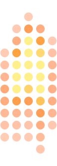

  
   
  <picture>
    <source media="(prefers-color-scheme: dark)" srcset="assets/title-dark.png">
    
  </picture>

  The world's first AI-powered candle. 
  A small neural network invents its flame on 144 amber lights, and never repeats itself.

<a href="https://digitalcandle.ai">digitalcandle.ai</a>

---

The firmware, the model and the tools for writing your own apps for the matrix will be
published here.